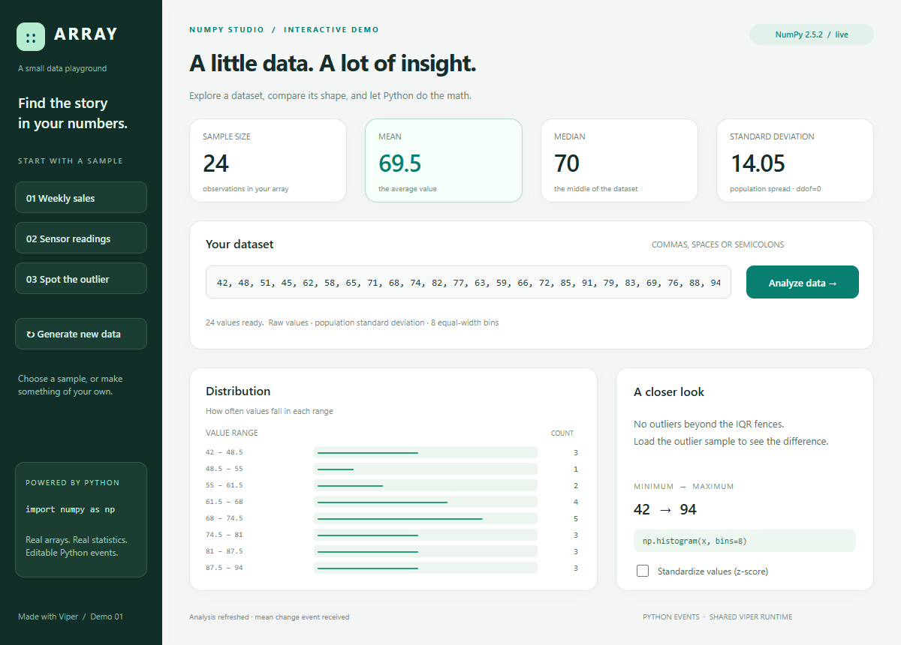

# Viper

**Build desktop interfaces visually. Write their behavior in Python.**

Viper combines a form designer, Python event editor and desktop runtime. Design
your interface, try it in Preview, then run or export the same project.
VIPER stands for *Visual Interface for Python Execution and Rendering*. 🐍

## What you can build today

- Forms with buttons, labels, text inputs, checkboxes and panels.
- Resizable interfaces with hard anchor links and Fixed/Stretch sizing.
- Python interactions using live control properties and imported modules.
- Styled applications with bundled Bootstrap/Milligram themes or your own CSS.
- Projects with multiple forms, a startup window, undo/redo and portable JSON files.
- Shareable Python project ZIPs and Windows executable ZIPs.



## Install and run

Run these commands from a checkout of this repository. **Python 3.11+** is required.

### Windows

Install [Microsoft WebView2 Runtime](https://developer.microsoft.com/microsoft-edge/webview2/), then:

```powershell
python -m venv .venv
.\.venv\Scripts\Activate.ps1
python -m pip install -e .
python -m viper.main
```

### Linux

Install **GTK 4**, **WebKitGTK 6.0** and **PyGObject** through your distribution.
On Ubuntu/Debian releases that provide WebKitGTK 6.0, the packages are
`gir1.2-gtk-4.0`, `gir1.2-webkit-6.0` and `python3-gi`.

```bash
python3 -m venv --system-site-packages .venv
source .venv/bin/activate
python -m pip install -e .
python -m viper.main
```

| Platform | Engine | Status |
| --- | --- | --- |
| Windows | WebView2 through pywebview | Native designer, runtime and export checks |
| Linux | GTK 4 + WebKitGTK 6.0 | Implemented; native verification pending |
| macOS | — | Not implemented |

## Try the NumPy demo

[Array — NumPy Studio](examples/numpy_studio/README.md) is a complete editable
dashboard with sample datasets, live statistics, a histogram and outlier detection.

```powershell
python -m pip install -r examples/numpy_studio/requirements.txt
python -m examples.numpy_studio.edit
```

Press **F6** to interact with it in Preview, or **F5** to run it in a separate
window. To launch the finished demo directly, use `python -m examples.numpy_studio.app`.

## Build your first app

1. Add controls from **Components** or **Insert > Widgets and Controls**.
2. Drag to position them, use the corner handle to resize, and edit properties in **Inspector**.
3. Choose **Connect Anchors**, then click a reference anchor and a follower anchor.
4. Double-click a control to open **Events**, choose an event, and click **Create handler**.
5. Preview with **F6**, run with **F5**, and save your project with **Ctrl+S**.

For example, the starter project's Launch button can read its input and update its label:

```python
def on_MainWindow_Launch_click(event):
    StatusLabel.Text = f"Hello, {NameInput.Text}!"
```

Select a window in **Project Explorer** to add module imports. Select the parent
project to choose its startup window and application CSS theme. Add more forms
with **+ Window**. Closing a form tab keeps its window in the project.

The [user guide](docs/USER_GUIDE.md) covers anchors, styling, Python imports,
control properties and the full editing workflow.

### Saving and undo

The title shows the project name and filename; **`*` means unsaved changes**.
**Save** writes to the current file without a dialog after the first save.
**Save As** chooses a new destination. Projects save as readable JSON, including
window definitions, themes and authored Python source.

Undo/redo covers project edits, including anchors, forms and event code. History
keeps up to 50 steps, subject to a memory limit, and resets on New/Open. Returning
to saved contents clears the `*`. Text fields retain their normal undo shortcuts.

| Action | Shortcut |
| --- | --- |
| New / Open | Ctrl+N / Ctrl+O |
| Save / Save As | Ctrl+S / Ctrl+Shift+S |
| Undo / Redo | Ctrl+Z / Ctrl+Shift+Z |
| Duplicate / Rename | Ctrl+D / F2 |
| Delete selected control, window or link | Delete |
| Preview / Stop Preview | F6 / Shift+F5 |
| Run application | F5 |
| Zoom in / out / fit | Ctrl+= / Ctrl+- / Ctrl+0 |

Click a connected anchor or line to select its link, then press **Delete**.
Repeated clicks on a shared anchor cycle through its links.

## Share your app

Choose the project's **Startup window**, then use **File > Build / Package**.

| Export | What recipients need |
| --- | --- |
| Python project ZIP | Python 3.11+, the generated requirements, and platform GUI dependencies; Viper is included |
| Windows executable ZIP | WebView2 Runtime and .NET Framework 4.8; Python is bundled |

For Windows executable builds, install the optional build tools first:

```powershell
python -m pip install -e ".[build]"
```

Both formats include the project and its saved Python handlers. Extract and keep
the application folder together. Windows executable export produces a folder
distribution; installers and Linux executable export are planned.

You can also export from the command line:

```powershell
python -m viper.build project.json --format python --output dist/MyApp_python.zip
python -m viper.build project.json --output dist/MyApp.zip
```

See [export requirements and dependency handling](docs/USER_GUIDE.md#exporting-and-sharing).

## What's next

The main focus is **a much larger element library**: dropdowns, radio groups,
sliders, numeric and date inputs, multiline editors, lists, tables, trees, images
and progress indicators. Layout containers and navigation controls are also planned.

Other planned improvements include multi-selection, clipboard and alignment tools,
runtime window navigation, Linux verification and easier application distribution.
See the [roadmap](ROADMAP.md) for the planned work; these features are still ahead.

## Development

```powershell
python -m pip install pytest
python -m pytest -q -p no:cacheprovider
```

Native Windows checks, including real pointer interactions:

```powershell
python tests/windows_smoke.py --pointer
```

See the [user guide](docs/USER_GUIDE.md#validation) for runtime and export checks.
[ARCHITECTURE.md](ARCHITECTURE.md) documents the shared designer/runtime design,
platform boundaries and development history.

## License

[MIT](LICENSE).
